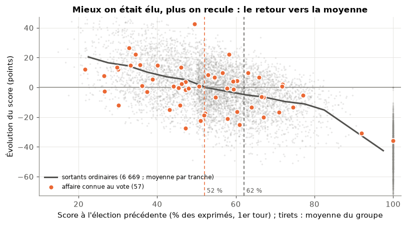

# Les électeurs sanctionnent-ils vraiment ?

Projet personnel de data science.

**Question.** Un maire visé par une affaire judiciaire (enquête, mise en examen,
condamnation) est-il sanctionné par les électeurs aux élections municipales
suivantes ? On compare les maires sortants des municipales de 2020 et de 2026 selon
qu'une affaire était connue ou non au moment du vote.

**Démarche.** On rapproche 741 affaires judiciaires recensées par deux bases
citoyennes (Casier Politique, Poligraph) des maires sortants de près de 44 000
communes x élection. Après élimination des homonymes et des maires partis en cours
de mandat, 75 sortants avaient une affaire connue au moment du vote. On les compare
à des sortants comparables par quatre approches : à taille de commune égale,
régressions avec contrôles (score précédent, taille, compétition, bord politique,
contexte socio-économique et présidentiel), appariement sur score de propension, et
comparaison à « notoriété égale » avec les élus dont l'affaire n'éclatera qu'après
le vote.


*Les sortants visés par une affaire connue au vote se concentrent en Île-de-France, sur
le pourtour méditerranéen et dans quelques grandes villes. La plupart se représentent et
gagnent.*

## Résultats

1. **Pas de sanction électorale robuste.** Les sortants visés par une affaire se
   représentent, conservent leur score et gagnent aussi souvent que des sortants
   comparables. Aucune approche ne trouve de perte de voix significative.

   

   *Sur le score, tous les intervalles contiennent zéro. Sur la victoire, seule la
   comparaison à notoriété égale (4) trouve un effet négatif.*

2. **Deux pièges expliquent les comparaisons naïves.** Le retour vers la moyenne :
   ces sortants avaient été moins bien élus la fois précédente (52 % contre 62 %),
   donc avaient moins à perdre ; la perte apparente de 5 points en 2026 disparaît
   une fois le score précédent contrôlé. La prime de notoriété : les élus recensés
   (grandes villes, figures nationales) gagnent davantage que les autres.

   

   *Mieux un sortant était élu, plus il recule. Les sortants visés par une affaire
   (en orange) partaient de plus bas, mais restent de part et d'autre de la courbe
   des sortants ordinaires.*

   

   *Les personnalités dont l'affaire n'éclatera qu'après le vote gagnent 93 % du
   temps, contre 74 % pour les sortants ordinaires : c'est la prime de notoriété.*

3. **Un seul indice de sanction, fragile.** À notoriété égale, une affaire révélée
   pendant le mandat réduit la probabilité de victoire d'environ 29 points
   (IC 95 % de -57 à -1, p = 0,04), sur une trentaine de cas et surtout en 2020.
4. **Ni le bord politique ni le stade de l'affaire ne changent ce constat.**
   La sanction ne paraît pas plus forte à gauche qu'à droite (écart non
   significatif). Une condamnation prononcée avant le vote réduirait la probabilité
   de victoire d'environ 26 points (p = 0,08), sans écart significatif avec une
   affaire pas encore jugée, et les élus déjà blanchis ne sont pas sanctionnés de
   façon détectable.

   

   *À notoriété égale, aucun stade ne coûte de voix ; les intervalles sur la victoire
   sont très larges, faute de cas.*

**Portée.** Les bases d'affaires ne couvrent que les élus assez connus pour avoir
une page Wikipédia ou une fiche Poligraph : les résultats valent pour les maires de
villes moyennes et grandes, pas pour les petites communes. Avec quelques dizaines
de cas, seul un effet important serait détectable.

Le résumé complet, avec tous les tableaux et figures, se lit directement sur GitHub dans
[`RESULTATS.md`](RESULTATS.md) (généré par `python main.py --markdown`) ; le détail des
analyses est dans [`notebooks/00_synthese.ipynb`](notebooks/00_synthese.ipynb).

## Reproduire les résultats

**Prérequis.** Python 3.12 (versions testées dans `requirements.txt`), une connexion
internet, environ 2 Go d'espace disque. Compter de 30 minutes à 1 heure au premier
lancement, surtout pour le téléchargement : environ 550 Mo, dont des fichiers de l'API
de l'INSEE parfois lente.

**1. Récupérer le projet et installer l'environnement**

```bash
git clone https://github.com/QuentinNosmas/Projet_ensae_datascience.git
cd Projet_ensae_datascience
python -m venv .venv
source .venv/bin/activate          # Windows (PowerShell) : .venv\Scripts\activate
pip install -r requirements.txt
```

**2. Obtenir le résumé de l'étude**

```bash
python main.py                    # toute la chaîne + résumé détaillé dans le terminal
python main.py --figures          # + figures dans sorties/figures/
python main.py --cache            # réutilise les tables déjà construites (plus rapide)
python main.py --markdown         # écrit le résumé dans RESULTATS.md (figures : docs/resultats/)
```

`main.py` enchaîne données, panel, affaires, contexte des communes et modèles, puis
imprime la question, les données, la référence, les quatre approches, l'analyse par
bord politique et par stade de l'affaire, la robustesse et la conclusion, avec des
chiffres recalculés à chaque exécution.

**3. Exécuter les notebooks**

```bash
python -m jupyter nbconvert --to notebook --execute --inplace notebooks/0*.ipynb
```

Les données ne sont pas versionnées : au premier lancement, chaque source manquante est
téléchargée depuis son URL publique dans `data/raw/`, puis nettoyée dans
`data/processed/`. Si l'API de l'INSEE coupe un transfert, le téléchargement reprend
automatiquement là où il s'était arrêté ; en cas d'échec, relancer la commande repart du
fichier partiel.

On peut aussi préparer les données à l'avance, étape par étape :

```bash
python scripts/download_data.py   # data/raw/ ; --list pour voir les sources
python src/load.py                # data/processed/*.parquet
python src/panel.py               # panel maire sortant x élection
python src/affaires.py            # affaires rattachées au panel
python src/covariables.py         # contexte socio-économique et politique des communes
```

**4. Régénérer les figures du README** (après l'étape 3)

```bash
python scripts/figures.py         # docs/figures/*.png, extraites des notebooks exécutés
```

**5. Vérifier la reproduction.** `main.py` et le notebook `00_synthese` doivent afficher notamment :
43 729 communes x élection dans le panel, 741 affaires recensées, 75 sortants avec une
affaire connue au vote (dont 40 révélée pendant le mandat), 6 772 observations dans les
modèles et, à notoriété égale, un effet de -29,3 points sur la probabilité de victoire
(IC 95 % de -57,5 à -1,2).

**Traçabilité des données.** `data/MANIFEST.json` (versionné) garde l'URL, la date de
téléchargement et l'empreinte SHA-256 de chaque fichier utilisé ; il n'est réécrit que si
un fichier change. Les deux bases d'affaires étant mises à jour en continu, on en
versionne un instantané daté (`data/snapshots/`, 1,8 Mo), utilisé par défaut ;
`python scripts/download_data.py --live` récupère la version du jour (les résultats
peuvent alors changer).

**Sous Windows.**

- Placer le projet dans un chemin court (par exemple `C:\projets\`) : au-delà de 260
  caractères, Windows refuse de charger certaines bibliothèques de `geopandas`, et la
  carte des communes échoue (« DLL load failed… nom de fichier trop long »).
- Lancer Jupyter par `python -m jupyter` plutôt que `jupyter` : le lanceur `jupyter.exe`
  garde en dur le chemin de Python de l'installation.
- Le fichier `.gitattributes` garde les instantanés de données intacts malgré la
  conversion des fins de ligne, pour que leurs empreintes correspondent au manifeste.

## Organisation

| Fichier | Rôle |
|---|---|
| `main.py` | point d'entrée : toute la chaîne et un résumé détaillé des résultats |
| `RESULTATS.md` | ce résumé, lisible sur GitHub (régénéré par `python main.py --markdown`) |
| `scripts/download_data.py` | téléchargement reproductible des sources (reprise, contrôles) |
| `scripts/figures.py` | export des figures du README depuis les notebooks exécutés |
| `src/load.py` | lecture et nettoyage de chaque source, codes INSEE harmonisés |
| `src/panel.py` | panel « maire sortant x élection » : candidature, score, victoire |
| `src/affaires.py` | rattachement des affaires judiciaires aux sortants, variables de traitement, stade de l'affaire au vote |
| `src/covariables.py` | recensement, revenus, présidentielles : contexte de chaque commune |
| `src/analyse.py` | comparaisons à taille de commune égale, intervalles bootstrap |
| `src/modeles.py` | régressions (MCO, logit), appariement sur score de propension, analyses de synthèse (quatre approches, bord politique, stade de l'affaire, robustesse) |
| `src/graphiques.py` | charte graphique, carte, graphique des estimations |
| `notebooks/00_synthese.ipynb` | synthèse : la démarche, les résultats et leurs limites |
| `notebooks/01_exploration.ipynb` | diagnostic des sources |
| `notebooks/02_panel_sortants.ipynb` | comportement d'un sortant « ordinaire » |
| `notebooks/03_affaires.ipynb` | affaires judiciaires : rattachement, description, carte, comparaisons à taille égale |
| `notebooks/04_modelisation.ipynb` | régressions, appariement, délai, participation, bord politique, stade de l'affaire, robustesse |

## Sources

| Source | Producteur | Licence |
|---|---|---|
| Résultats et candidatures des municipales 2014, 2020, 2026 | Ministère de l'Intérieur (data.gouv.fr) | Licence Ouverte |
| Maires sortants 2026, Répertoire national des élus | Ministère de l'Intérieur (data.gouv.fr) | Licence Ouverte |
| Code officiel géographique 2026 | INSEE | Licence Ouverte |
| Recensement 2017 et 2023, revenus Filosofi 2023 (API Melodi) | INSEE | Licence Ouverte |
| Présidentielles 2017 et 2022 | Ministère de l'Intérieur (data.gouv.fr) | Licence Ouverte |
| Contours des communes 2025 | Etalab (data.gouv.fr) | ODbL |
| Affaires judiciaires : condamnations | [Casier Politique](https://casier-politique.fr/about) | CC BY-NC-SA 4.0 |
| Affaires judiciaires : tous stades | [Poligraph](https://poligraph.fr) | données publiques, code AGPL-3.0 |

Il n'existe pas de base officielle nominative des procédures visant des élus. Les
deux bases d'affaires sont des initiatives citoyennes, mises à jour en continu, qui
ne couvrent que les élus ayant une page Wikipédia ou une fiche Poligraph : surtout
des maires de grandes villes et des élus nationaux. Les limites qui en découlent
sont discutées dans la synthèse (notebook 00, section 7).
