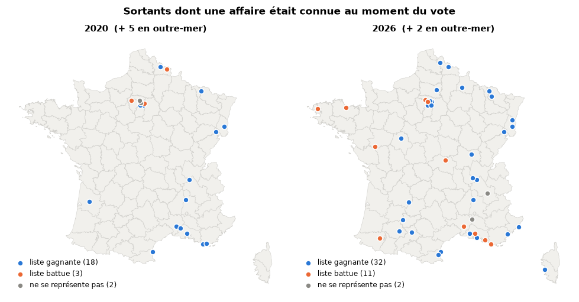
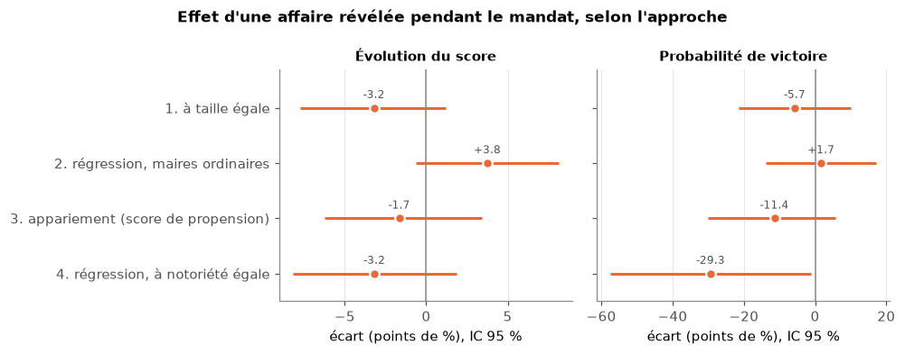
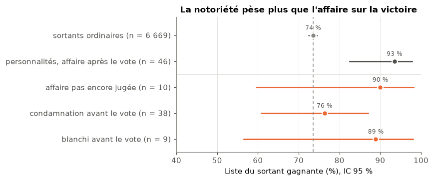
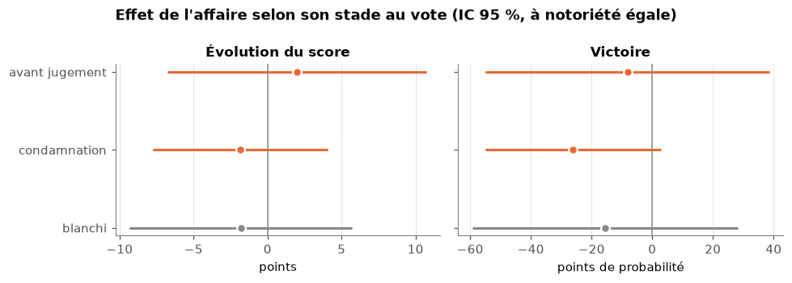

# Les électeurs sanctionnent-ils vraiment ?

*Projet de data science sur les maires visés par une affaire judiciaire et leur
réélection aux municipales de 2020 et 2026.*

## Question

Un maire visé par une affaire judiciaire (enquête, mise en examen, condamnation)
est-il sanctionné par les électeurs à l'élection municipale suivante ? On compare les
maires sortants selon qu'une affaire était connue ou non au moment du vote, sur trois
résultats : le sortant se représente-t-il, comment évolue son score au 1er tour, sa
liste gagne-t-elle ?

## Démarche

- **Données électorales** : résultats et candidatures des municipales 2014, 2020 et
  2026, pour près de 44 000 communes x élection, réunis dans un panel « maire sortant
  x élection ».
- **Affaires judiciaires** : 741 affaires recensées par deux bases citoyennes (Casier
  Politique, Poligraph), rattachées aux sortants après élimination des homonymes et
  des maires partis en cours de mandat. 75 sortants avaient une affaire connue au
  moment du vote.
- **Contexte des communes** : recensement, revenus et vote aux présidentielles (INSEE,
  ministère de l'Intérieur).
- **Quatre approches** pour comparer ces sortants à des sortants comparables : à
  taille de commune égale, régressions avec contrôles (score précédent, taille,
  compétition, bord politique, contexte local), appariement sur score de propension,
  et comparaison « à notoriété égale » avec les élus dont l'affaire n'éclatera
  qu'après le vote.



*Les sortants visés par une affaire connue au vote se concentrent en Île-de-France, sur
le pourtour méditerranéen et dans quelques grandes villes. La plupart se représentent et
gagnent.*

## Résultats

**1. Pas de sanction électorale robuste.** Les sortants visés par une affaire se
représentent, conservent leur score et gagnent aussi souvent que des sortants
comparables. Aucune approche ne trouve de perte de voix significative.



*Sur le score, tous les intervalles contiennent zéro. Sur la victoire, seule la
comparaison à notoriété égale (4) trouve un effet négatif.*

**2. Deux pièges expliquent les comparaisons naïves.**

- *Le retour vers la moyenne* : ces sortants avaient été moins bien élus la fois
  précédente (52 % contre 62 %), donc avaient moins à perdre. La perte apparente de
  5 points en 2026 disparaît une fois le score précédent contrôlé.
- *La prime de notoriété* : les élus recensés (grandes villes, figures nationales)
  gagnent davantage que les autres.


*Mieux un sortant était élu, plus il recule. Les sortants visés par une affaire (en
orange) partaient de plus bas, mais restent de part et d'autre de la courbe des
sortants ordinaires.*



*Les personnalités dont l'affaire n'éclatera qu'après le vote gagnent 93 % du temps,
contre 74 % pour les sortants ordinaires : c'est la prime de notoriété.*

**3. Un seul indice de sanction, fragile.** À notoriété égale, une affaire révélée
pendant le mandat réduit la probabilité de victoire d'environ 29 points (IC 95 % de
-57 à -1, p = 0,04), sur une trentaine de cas et surtout en 2020.

**4. Ni le bord politique ni le stade de l'affaire ne changent ce constat.** La
sanction ne paraît pas plus forte à gauche qu'à droite (écart non significatif). Une
condamnation prononcée avant le vote réduirait la probabilité de victoire d'environ
26 points (p = 0,08), sans écart significatif avec une affaire pas encore jugée, et
les élus déjà blanchis ne sont pas sanctionnés de façon détectable.



*À notoriété égale, aucun stade ne coûte de voix ; les intervalles sur la victoire sont
très larges, faute de cas.*

## Portée et limites

- **Couverture** : les bases d'affaires ne recensent que les élus assez connus pour
  avoir une page Wikipédia ou une fiche Poligraph. Les résultats valent pour les
  maires de villes moyennes et grandes, pas pour les petites communes.
- **Puissance** : avec quelques dizaines de cas, seul un effet important serait
  détectable.
- **Datation** : une affaire est datée par le début de la procédure ou le verdict,
  souvent après sa révélation dans la presse.

## Pour aller plus loin

- [`RESULTATS.md`](RESULTATS.md) : le résumé complet de l'étude, avec tous les
  tableaux et figures.
- [`notebooks/00_synthese.ipynb`](notebooks/00_synthese.ipynb) : la synthèse, puis le
  détail de chaque étape dans les notebooks 01 à 04.

## Lancer le projet

Avec Python 3.12 :

```bash
git clone https://github.com/QuentinNosmas/Projet_ensae_datascience.git
cd Projet_ensae_datascience
pip install -r requirements.txt
python main.py
```

`main.py` télécharge les données publiques manquantes (environ 550 Mo au premier
lancement), construit toutes les tables et affiche le résumé de l'étude ;
`python main.py --markdown` régénère `RESULTATS.md`. Les notebooks s'exécutent de la
même façon, de bout en bout :
`python -m jupyter nbconvert --to notebook --execute --inplace notebooks/0*.ipynb`.

## Organisation du dépôt

| Fichier | Rôle |
|---|---|
| `main.py` | point d'entrée : toute la chaîne de traitement et le résumé des résultats |
| `RESULTATS.md` | résumé de l'étude, généré par `main.py` |
| `notebooks/00_synthese.ipynb` | synthèse : démarche, résultats et limites |
| `notebooks/01_exploration.ipynb` | diagnostic des sources |
| `notebooks/02_panel_sortants.ipynb` | comportement d'un maire sortant « ordinaire » |
| `notebooks/03_affaires.ipynb` | affaires judiciaires : rattachement, description, carte |
| `notebooks/04_modelisation.ipynb` | régressions, appariement, délai, participation, bord politique, stade de l'affaire, robustesse |
| `scripts/download_data.py` | téléchargement des sources |
| `scripts/figures.py` | export des figures du README |
| `src/load.py` | lecture et nettoyage de chaque source |
| `src/panel.py` | panel « maire sortant x élection » |
| `src/affaires.py` | rattachement des affaires aux sortants, date et stade au vote |
| `src/covariables.py` | contexte socio-économique et politique des communes |
| `src/analyse.py` | comparaisons à taille de commune égale |
| `src/modeles.py` | régressions, appariement sur score de propension, analyses de synthèse |
| `src/graphiques.py` | charte graphique et figures |

## Sources

| Source | Producteur | Licence |
|---|---|---|
| Résultats et candidatures des municipales 2014, 2020, 2026 | Ministère de l'Intérieur (data.gouv.fr) | Licence Ouverte |
| Maires sortants 2026, Répertoire national des élus | Ministère de l'Intérieur (data.gouv.fr) | Licence Ouverte |
| Code officiel géographique 2026 | INSEE | Licence Ouverte |
| Recensement 2017 et 2023, revenus Filosofi 2023 | INSEE | Licence Ouverte |
| Présidentielles 2017 et 2022 | Ministère de l'Intérieur (data.gouv.fr) | Licence Ouverte |
| Contours des communes 2025 | Etalab (data.gouv.fr) | ODbL |
| Affaires judiciaires : condamnations | [Casier Politique](https://casier-politique.fr/about) | CC BY-NC-SA 4.0 |
| Affaires judiciaires : tous stades | [Poligraph](https://poligraph.fr) | données publiques, code AGPL-3.0 |

Il n'existe pas de base officielle nominative des procédures visant des élus : les deux
bases d'affaires sont des initiatives citoyennes, dont on utilise un instantané daté
(`data/snapshots/`).

`data/MANIFEST.json` garde l'URL et l'empreinte SHA-256 de chaque fichier utilisé. Si une
source officielle disparaît (c'est le cas des résultats de 2014 et du Répertoire national
des élus d'août 2026, retirés de data.gouv.fr), le téléchargement se rabat sur une copie
d'Internet Archive, acceptée seulement si son empreinte est identique à l'originale.
