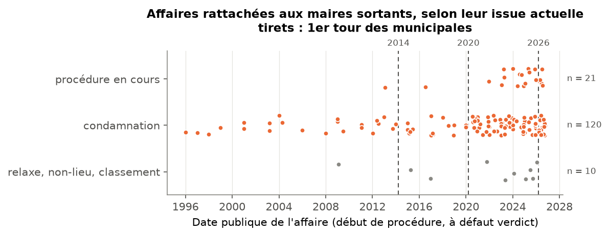
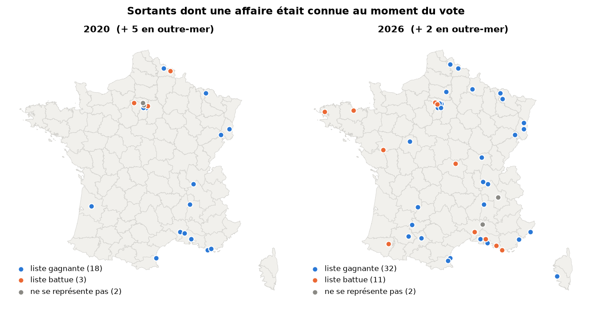
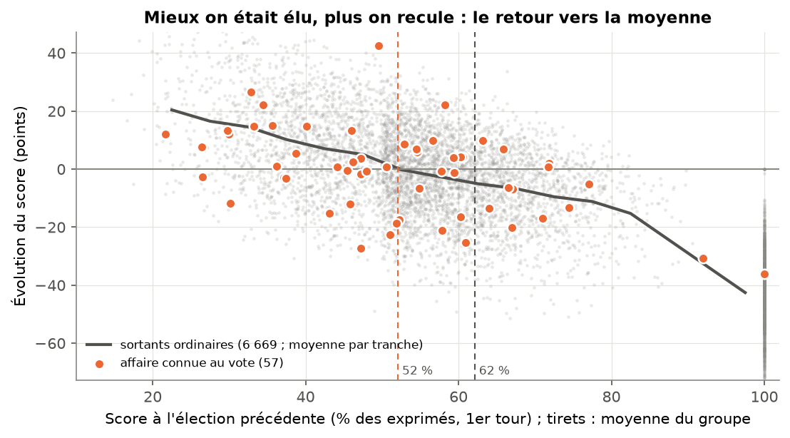
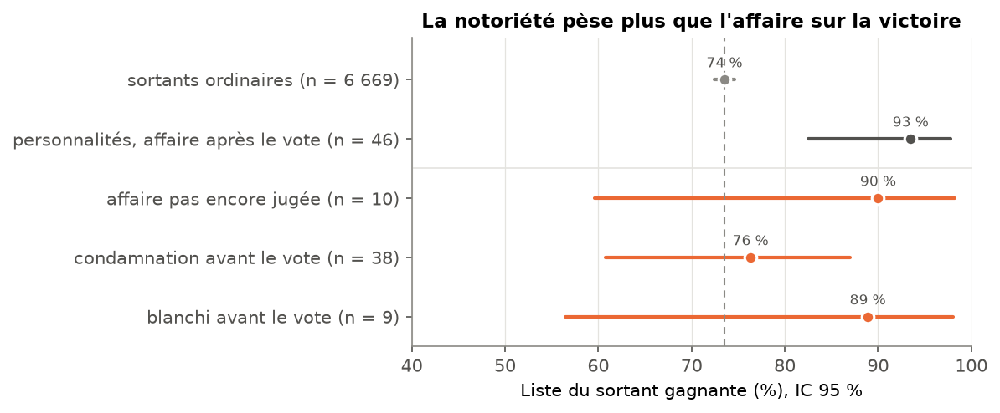
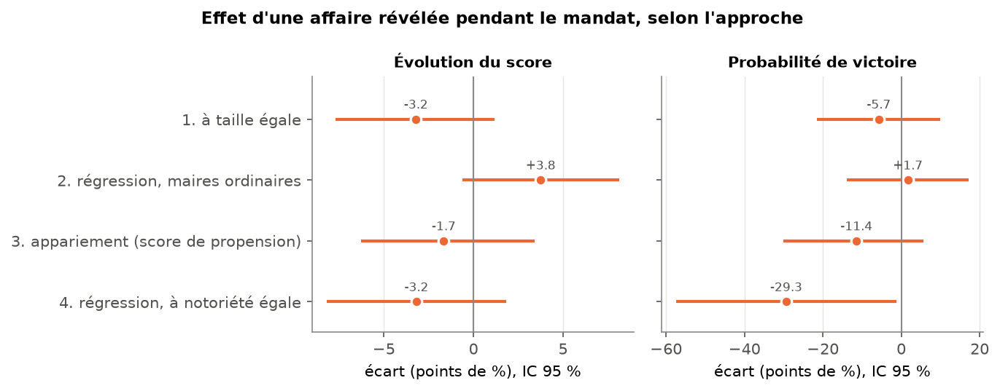

# Les électeurs sanctionnent-ils les maires visés par une affaire judiciaire ?

*Municipales 2020 et 2026 : résumé de l'étude. Fichier généré par `python main.py --markdown` le 25/11/2026, à partir des données et du code du dépôt ; ne pas le modifier à la main. Détail des analyses : [notebooks/](notebooks/).*

## Question et stratégie

La science politique décrit un avantage du sortant : le maire qui se représente gagne le plus souvent. Une affaire judiciaire (enquête, mise en examen, condamnation) devrait l'entamer si les électeurs sanctionnent les manquements à la probité. On compare donc les maires sortants visés par une affaire connue au moment du vote aux autres sortants, aux municipales de 2020 et de 2026.

Trois résultats sont mesurés : le sortant se représente-t-il ? Comment évolue son score au 1er tour par rapport à l'élection précédente ? Sa liste gagne-t-elle ?

Deux difficultés guident la démarche. Les sortants visés par une affaire ne sont pas des maires comme les autres (grandes villes, figures nationales) : il faut comparer à caractéristiques égales. Et les sources d'affaires ne recensent que des élus connus : il faut séparer l'effet de l'affaire de celui de la notoriété.

## 1. Données

Sources : résultats et candidatures des municipales 2014, 2020 et 2026, maires sortants 2026 et Répertoire national des élus (ministère de l'Intérieur), Code officiel géographique et contours des communes (INSEE, Etalab), recensement 2017 et 2023 et revenus Filosofi (INSEE), présidentielles 2017 et 2022. Il n'existe pas de base officielle nominative des procédures visant des élus : les affaires viennent de deux bases citoyennes, Casier Politique (condamnations extraites de Wikipédia) et Poligraph (affaires à tous les stades), dont on utilise un instantané daté (data/snapshots/) pour que les résultats ne changent pas avec leurs mises à jour.

|  | effectif |
|---|---|
| communes x élection dans le panel | 43 729 |
| affaires recensées (deux sources) | 741 |
| personnalités recensées | 517 |
| rapprochements personnalité-sortant confirmés | 181 |
| &nbsp;&nbsp;&nbsp;&nbsp;rejetés : homonymes probables | 31 |
| &nbsp;&nbsp;&nbsp;&nbsp;rejetés : plus maire au scrutin | 18 |
| sortants avec une affaire connue au vote | 75 |
| &nbsp;&nbsp;&nbsp;&nbsp;dont révélée pendant le mandat | 40 |
| &nbsp;&nbsp;&nbsp;&nbsp;dont atteinte à la probité | 40 |
| sortants dont l'affaire n'éclate qu'après le vote | 68 |
| échantillon des modèles (têtes de liste, communes disputées) | 6 772 |

Le rapprochement est conservateur : une personnalité n'est rattachée à un sortant que si sa date de naissance ou le nom de la commune cité dans sa fiche confirme l'identité, et seulement s'il était encore maire au scrutin (beaucoup d'élus nationaux ont quitté leur mairie en 2017, avec la fin du cumul des mandats).

Une affaire est datée par le début de la procédure, à défaut par le verdict : c'est une borne tardive, car la presse la révèle souvent plus tôt. Elle est « connue au vote » si cette date précède le 1er tour, « révélée pendant le mandat » si elle tombe entre les deux élections.

*Affaires rattachées aux maires sortants, selon leur date et leur issue actuelle*

## 2. La référence : le maire sortant ordinaire

|  | 2020 | 2026 |
|---|---|---|
| se représente (%) | 66,8 | 73,5 |
| conduit sa liste, s'il se représente (%) | 89,2 | 86,9 |
| sa liste gagne, communes disputées (%) | 74,0 | 70,1 |
| évolution médiane du score (points) | -1,7 | -6,3 |

Un maire sortant ordinaire se représente 67 % du temps en 2020 et 74 % en 2026. Quand il y a compétition, sa liste gagne environ 7 fois sur 10 : c'est l'avantage du sortant. Son score évolue beaucoup d'une élection à l'autre : c'est le bruit de fond dans lequel il faut détecter une éventuelle sanction.

## 3. Les sortants visés par une affaire

*Sortants dont une affaire était connue au moment du vote, selon l'issue du scrutin*

| groupe | effectif | inscrits (médiane) | listes | score précédent (%) | évolution du score (pts) | victoire (%) |
|---|---|---|---|---|---|---|
| affaire connue au vote | 57 | 27 444 | 5,2 | 52,0 | -1,1 | 80,7 |
| autres sortants | 6 669 | 2 586 | 2,6 | 62,1 | -7,3 | 73,5 |
| personnalité, affaire future | 46 | 25 936 | 5,6 | 50,1 | 1,0 | 93,5 |

Les sortants visés par une affaire dirigent des villes bien plus grandes (27 444 inscrits en médiane, contre 2 586), avec plus de listes en compétition, et avaient été moins bien élus la fois précédente (52 % contre 62 %).

Premier piège, le retour vers la moyenne : un sortant très bien élu a plus à perdre. Les sortants avec affaire partaient de plus bas ; ils reculent donc moins (évolution moyenne du score de -1,1 contre -7,3 points) sans que l'affaire y soit pour rien. Il faut contrôler le score précédent.

*Retour vers la moyenne : évolution du score selon le score précédent*

Second piège, la notoriété : les personnalités dont l'affaire n'éclatera qu'après le vote leur ressemblent beaucoup, mais gagnent 93 % du temps, contre 74 % pour les sortants ordinaires. Les élus assez connus pour figurer dans nos sources bénéficient d'une prime électorale.

*Taux de victoire selon la notoriété et le stade de l'affaire*

## 4. Une affaire révélée pendant le mandat coûte-t-elle des voix ?

Quatre approches, sur le même échantillon (sortants têtes de liste aux deux élections, communes disputées les deux fois) : (1) écart avec les sortants sans affaire des communes de même taille ; (2) régression contre les maires ordinaires, avec contrôle du score précédent, de la taille, du nombre de listes, du bord politique, du contexte socio-économique et présidentiel ; (3) appariement sur le score de propension (5 « jumeaux » par sortant visé) ; (4) même régression, avec une indicatrice de notoriété : la comparaison se fait alors avec des personnalités dont l'affaire n'a éclaté qu'après le vote. Effets en points de pourcentage, avec intervalle de confiance à 95 %.

|  | Évolution du score / effet | Évolution du score / IC bas | Évolution du score / IC haut | Probabilité de victoire / effet | Probabilité de victoire / IC bas | Probabilité de victoire / IC haut |
|---|---|---|---|---|---|---|
| 1. à taille égale | -3,2 | -7,7 | 1,2 | -5,7 | -21,6 | 10,0 |
| 2. régression, maires ordinaires | 3,8 | -0,6 | 8,1 | 1,7 | -13,8 | 17,2 |
| 3. appariement (score de propension) | -1,7 | -6,3 | 3,4 | -11,4 | -30,0 | 5,7 |
| 4. régression, à notoriété égale | -3,2 | -8,2 | 1,8 | -29,3 | -57,5 | -1,2 |

*Effet d'une affaire révélée pendant le mandat, selon l'approche (IC 95 %)*

Score : les estimations vont de -3,2 à +3,8 points selon l'approche, et tous les intervalles contiennent zéro. La perte observée à taille égale (-3,2) disparaît une fois le score précédent contrôlé (+3,8).

Victoire : face à des maires ordinaires, l'affaire ne change pas significativement la probabilité de gagner (approches 1 à 3). À notoriété égale (approche 4), l'effet est de -29,3 points (IC 95 % : -57,5 à -1,2) : c'est le seul signal de sanction de l'étude, fragile (une trentaine de cas, surtout en 2020).

## 5. Selon le bord politique

### Sortants avec affaire connue, selon le bord de leur liste

| bord | sortants | évolution du score (pts) | victoire (%) |
|---|---|---|---|
| autre | 11 | 3,5 | 81,8 |
| droite | 35 | -2,2 | 85,7 |
| gauche | 11 | -2,3 | 63,6 |

### Effets à notoriété égale (score en points, victoire en effet marginal)

|  | coef. | IC bas | IC haut | p |
|---|---|---|---|---|
| évolution du score (pts) / affaire, sortant de gauche | -3,497 | -12,967 | 5,974 | 0,469 |
| évolution du score (pts) / affaire, sortant de droite | 0,735 | -5,258 | 6,728 | 0,810 |
| évolution du score (pts) / affaire, autre bord | -5,130 | -12,552 | 2,292 | 0,175 |
| évolution du score (pts) / notoriété (personnalité recensée) | 6,664 | 2,801 | 10,528 | 0,001 |
| victoire (effet marginal) / affaire, sortant de gauche | -0,315 | -0,689 | 0,060 | 0,099 |
| victoire (effet marginal) / affaire, sortant de droite | -0,148 | -0,451 | 0,155 | 0,339 |
| victoire (effet marginal) / affaire, autre bord | -0,294 | -0,652 | 0,065 | 0,108 |
| victoire (effet marginal) / notoriété (personnalité recensée) | 0,306 | 0,068 | 0,544 | 0,012 |

Les estimations vont dans le sens d'une sanction plus forte à gauche, mais l'écart gauche - droite est non significatif sur le score (p = 0,42) et non significatif sur la victoire (p = 0,34).

## 6. Selon le stade de l'affaire au moment du vote

Les sources ne donnent que le statut actuel de l'affaire ; on reconstruit son stade au 1er tour avec la date du verdict : soupçon (pas de juge saisi), procédure judiciaire (mise en examen, instruction, procès en cours), condamnation déjà prononcée, ou élu déjà blanchi (relaxe, non-lieu, classement avant le vote).

| stade de l'affaire au vote | sortants | dont 2026 | inscrits (médiane) | score précédent (%) | évolution du score (pts) | victoire (%) |
|---|---|---|---|---|---|---|
| 0 personnalité, affaire future | 46 | 6 | 25 936 | 50,1 | 1,0 | 93,5 |
| 1 soupçon | 3 | 3 | 18 343 | 53,3 | -4,4 | 100,0 |
| 2 procédure | 7 | 5 | 37 588 | 51,3 | 1,7 | 85,7 |
| 3 condamnation | 38 | 22 | 25 216 | 49,7 | -0,2 | 76,3 |
| blanchi | 9 | 7 | 25 632 | 62,1 | -6,2 | 88,9 |
| sortant ordinaire | 6 669 | 3 462 | 2 586 | 62,1 | -7,3 | 73,5 |

### Effets à notoriété égale (score en points, victoire en effet marginal)

|  | coef. | IC bas | IC haut | p |
|---|---|---|---|---|
| évolution du score (pts) / ordinal / stade de l'affaire (0 à 3) | -0,586 | -2,526 | 1,355 | 0,554 |
| évolution du score (pts) / ordinal / élu déjà blanchi | -2,093 | -9,563 | 5,378 | 0,583 |
| évolution du score (pts) / ordinal / notoriété (personnalité recensée) | 6,981 | 3,145 | 10,818 | 0,000 |
| victoire (effet marginal) / ordinal / stade de l'affaire (0 à 3) | -0,092 | -0,191 | 0,006 | 0,067 |
| victoire (effet marginal) / ordinal / élu déjà blanchi | -0,172 | -0,609 | 0,264 | 0,439 |
| victoire (effet marginal) / ordinal / notoriété (personnalité recensée) | 0,323 | 0,082 | 0,565 | 0,009 |
| évolution du score (pts) / par niveau / affaire pas encore jugée | 1,973 | -6,737 | 10,684 | 0,657 |
| évolution du score (pts) / par niveau / condamnation avant le vote | -1,862 | -7,709 | 3,985 | 0,533 |
| évolution du score (pts) / par niveau / élu déjà blanchi | -1,814 | -9,283 | 5,656 | 0,634 |
| évolution du score (pts) / par niveau / notoriété (personnalité recensée) | 6,713 | 2,849 | 10,578 | 0,001 |
| victoire (effet marginal) / par niveau / affaire pas encore jugée | -0,082 | -0,546 | 0,382 | 0,729 |
| victoire (effet marginal) / par niveau / condamnation avant le vote | -0,261 | -0,548 | 0,027 | 0,075 |
| victoire (effet marginal) / par niveau / élu déjà blanchi | -0,155 | -0,591 | 0,280 | 0,485 |
| victoire (effet marginal) / par niveau / notoriété (personnalité recensée) | 0,306 | 0,068 | 0,544 | 0,012 |

Une condamnation prononcée avant le vote réduirait la probabilité de victoire de 26 points (p = 0,08, significatif au seuil de 10 % seulement), sans écart significatif avec une affaire pas encore jugée (p = 0,42). Les élus déjà blanchis ne sont pas sanctionnés de façon détectable (p = 0,48).

## 7. Robustesse : élection par élection

Effet d'une affaire révélée pendant le mandat sur le score, estimé séparément pour 2020 (sortant approché par la tête de la liste gagnante de 2014) et 2026 (liste officielle des sortants), avec et sans l'indicatrice de notoriété.

|  | coef. | IC bas | IC haut | p |
|---|---|---|---|---|
| 2020 / sans notoriété | 2,14 | -5,78 | 10,06 | 0,60 |
| 2020 / avec notoriété | -5,06 | -13,42 | 3,31 | 0,24 |
| 2026 / sans notoriété | 3,76 | -0,69 | 8,22 | 0,10 |
| 2026 / avec notoriété | 5,73 | -5,84 | 17,30 | 0,33 |

Contre des maires ordinaires, aucune élection ne montre de perte de voix. À notoriété égale, l'effet n'est négatif qu'en 2020 ; en 2026, la comparaison est presque impossible : il ne reste que 6 personnalités sans affaire connue, les affaires futures n'ayant pas encore eu le temps d'éclater.

## Conclusion

Les électeurs sanctionnent-ils vraiment ? Avec les données disponibles, pas de manière détectable. Un maire visé par une affaire judiciaire connue au moment du vote ne perd ni plus de voix ni plus souvent sa mairie qu'un maire comparable.

Le seul indice de sanction apparaît quand on le compare à des élus aussi connus que lui : -29,3 points (IC 95 % : -57,5 à -1,2) sur la probabilité de victoire. La sanction existerait alors, mais serait masquée par l'avantage électoral de la notoriété.

Ni le bord politique ni le stade de l'affaire (soupçon, procédure, condamnation) ne changent significativement ce constat.

### Limites

1. Couverture : seuls les élus ayant une page Wikipédia ou une fiche Poligraph sont recensés ; les résultats valent pour les villes moyennes et grandes, pas pour les petites communes.

2. Datation : la date de procédure ou de verdict est postérieure à la révélation médiatique ; certaines affaires classées « après le vote » étaient peut-être déjà connues.

3. Sortants 2020 : faute de liste officielle, le sortant est approché par la tête de la liste gagnante de 2014 ; les départs en cours de mandat ne sont corrigés que pour les personnalités recensées.

4. Puissance : avec quelques dizaines de cas, seul un effet important serait détectable ; l'absence de preuve n'est pas la preuve de l'absence.

5. Causalité : même à caractéristiques et notoriété égales, les affaires ne sont pas attribuées au hasard (un maire sous pression peut renoncer à se représenter).
